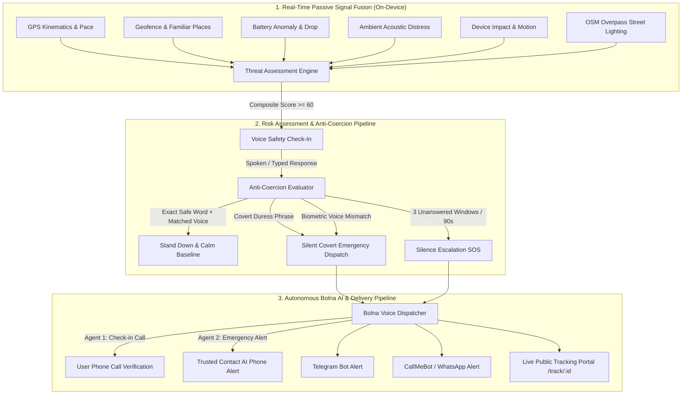

# Astraea — Autonomous Personal Safety PWA

> **Built for the Bolna Buildathon 2026**  
> Voice-first, multimodal personal safety platform that watches over you hands-free.

Astraea passively fuses on-device sensor kinematics and environmental signals into an active threat score. When threat factors compound, it initiates hands-free conversational check-ins. If the user fails to respond, speaks a covert duress phrase, or exhibits a biometric voice mismatch, Astraea autonomously initiates **Bolna AI voice phone calls** to trusted emergency contacts, dispatches live tracking coordinates, and arms direct emergency lifelines.

---

## 🏛️ System Architecture



---

## 🚀 Key Innovations & Phase Highlights

### 1. 🛡️ Security Vault & Anti-Coercion Delay (Phase 3)
- **iPhone Stolen Device Protection Style:** Changing secret safe words or disabling trusted contacts requires a 6-digit PIN (salted SHA-256 via Web Crypto API).
- **Location-Aware Security Delay:** Within 500m of saved trusted locations, updates apply immediately. Away from safe zones, modifications trigger a **mandatory 2-hour delay** (60s in `?dev=1`), keeping old safe phrases active to prevent forced override by an attacker.

### 2. 🎙️ On-Device Biometric Speaker Verification (Phase 5)
- Extracts 16-band log-filterbank spectral energy profiles via Web Audio API.
- Computes cosine similarity between live speech and the user's enrolled voice template entirely in the browser.
- **Anti-Coercion Detection:** If the phonetic words match but the acoustic voice profile deviates significantly, a silent covert alert is triggered.

### 3. 🌐 Multi-Language Voice Triggers & Screen Wake Lock (Phase 4)
- Natural language safety trigger dictionary supporting **English, Hindi, and Hinglish** (`"help me"`, `"bachao"`, `"madad chahiye"`, `"darr lag raha hai"`).
- Automatically acquires **Screen Wake Lock** during active listening to prevent screen dimming on Android and iOS mobile browsers.

### 4. 🤖 Autonomous Bolna AI Calling & Webhook Pipeline (Phases 6 & 7)
- Outbound calling using **Bolna Voice Agents**:
  - **Check-In Agent (`0885f542-dbc4-48c6-9780-fe1107c659ea`):** Calls user directly to prompt for verbal stand-down confirmation.
  - **Emergency Alert Agent (`f2a46049-af9e-4ef3-8021-d42c665046c3`):** Calls primary trusted contact with emergency briefing and live tracking URL.
- **Safety Rails:** Minimum 20-second cooldown per phone number to prevent feedback loops, input validation, and dry-run testing modes.

### 5. 📍 Public Live Tracking Portal (`/track/:id`) (Phase 8)
- Standalone, lightweight public tracking page for emergency recipients.
- Renders live pulsing location pin, breadcrumb GPS trail, speed, accuracy, and direct `tel:112` police calling links.
- Strips all internal secrets, passwords, and sensitive credentials.

### 6. 🚦 Multi-Tier Escalation State Machine (Phase 9)
- Formally managed transitions: `IDLE` ➔ `MONITORING` ➔ `CHECK_IN` ➔ `ESCALATED` ➔ `RESOLVED`.
- 3rd missed check-in automatically dispatches Bolna calls and surfaces immediate `tel:` click-to-call lifelines.

### 7. 🏙️ OpenStreetMap Overpass Environmental Signal (Phase 10)
- Real-time queries for commercial amenities, street lights, and emergency infrastructure within 350m radius.
- Identifies deserted corridors and elevates baseline isolation risk offset.
- 10-minute local geo-grid caching prevents repeated queries and respects OSM usage policies.

### 8. 🪫 Low-Battery & Offline Cellular Fallbacks (Phase 11)
- Battery ≤ 20%: Throttles polling and activates Battery Saver mode.
- Battery ≤ 5%: Dispatches emergency final GPS snapshot before device powers down.
- Offline Mode: Surfaces direct `sms:` emergency links and `tel:112` national emergency services.

### 9. 📞 Fake Escape Call Protocol (Phase 12)
- Simulates an authentic incoming phone call from "Mom" or "Office" with Web Audio dual-frequency ringtone synthesis (440Hz + 480Hz).
- Answering the call plays believable conversational voice audio ("Hey, where are you? Dinner is ready, hurry up outside!"), providing a socially indisputable exit strategy.

---

## 🛠️ Getting Started

### 1. Prerequisites
- Node.js 18+ (tested on Node 20 & Node 24)
- Modern web browser (Chrome or Safari recommended for Speech & Audio APIs)

### 2. Setup
```bash
git clone https://github.com/Astraea-Personal-Safety/Astraea.git
cd Astraea
npm install
```

### 3. Environment Configuration
Copy `.env.example` to `.env.local` and populate credentials:
```bash
cp .env.example .env.local
```

### 4. Running Locally
```bash
# Start development server
npm run dev

# Run comprehensive test suite across all branches
npm test

# Build production bundle
npm run build
```

---

## 🧪 Judge & Demonstration Lab (`?dev=1`)

To test Astraea without walking outside at night or waiting 2 hours for security delays, launch with the `?dev=1` parameter:
```
http://localhost:5173/?dev=1
```

The **Dev Tools** floating button enables:
- **Instant Threat Presets:** Safe Baseline, Night Walk, Deserted Run, Stationary Isolated, Scream Detected, Fall Detected, Compound Threat.
- **60-Second Security Delay:** Reduces 2-hour anti-coercion vault delay to 60 seconds for instant judge evaluation.
- **Biometric Voice Simulator:** Test pronunciation and speaker verification profiles directly in-browser.
- **Fake Escape Call:** Trigger an incoming phone call immediately with one tap.

---

## 🔒 Privacy & Threat Model

1. **Zero-Knowledge Core:** Safe words, duress phrases, and biometric voice templates are stored in client-side storage (`localStorage` & Web Crypto). Raw microphone audio never leaves the phone.
2. **Anti-Coercion Design:** If an attacker forces the user to speak or disarm the app:
   - Entering the covert duress phrase shows a simulated "Safe word verified • Alert stood down" screen while silently firing an emergency alert to contacts.
   - Significant voice mismatch under coercion triggers silent escalation.
   - Modifying settings away from home is blocked by the 2-hour security delay.
3. **Honest Technical Limitations:**
   - Web browsers cannot initiate background telephone calls without user initiation (`tel:`) or cloud APIs (Bolna).
   - Web Speech STT requires an active browser tab or Screen Wake Lock.
   - Emergency services (112/100) are never automatically dialed without explicit user tap.

---

## 📄 License
MIT License. Built for the Bolna Buildathon 2026.
